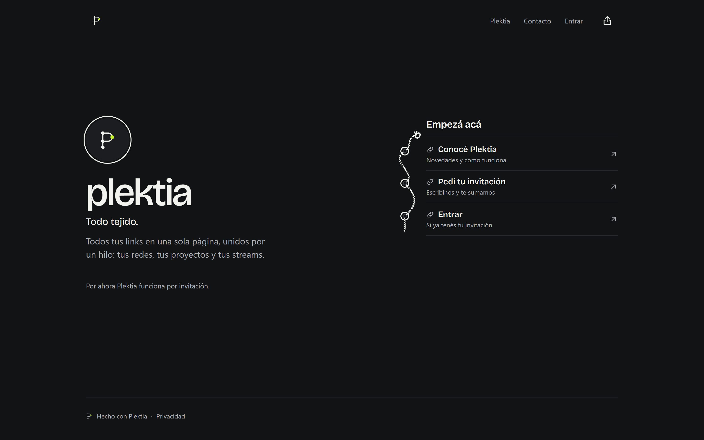
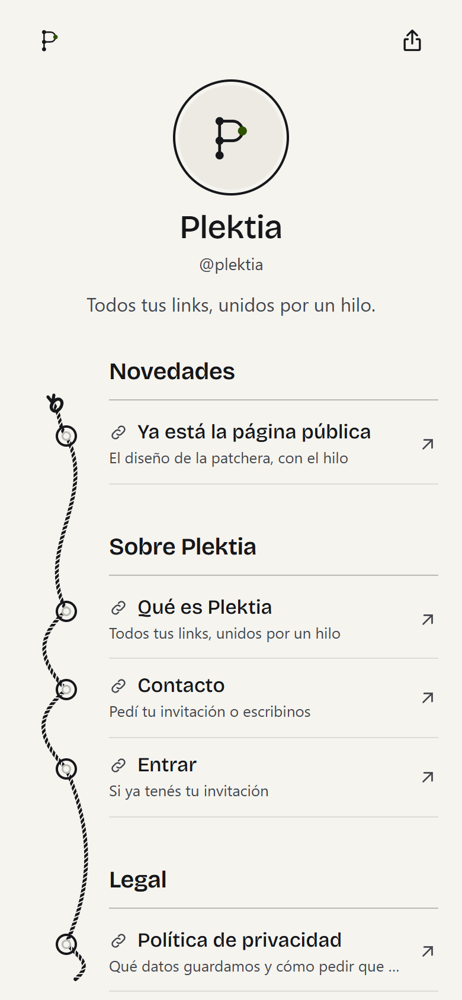
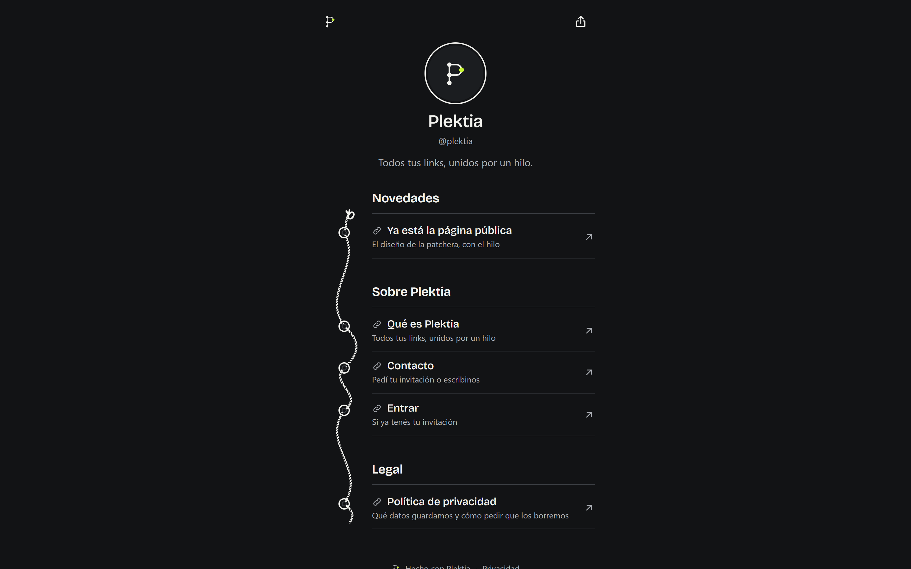

# Plektia

**Todos tus links en una sola página, unidos por un hilo.** Plektia es una página de links
para creadores que sabe cuándo estás transmitiendo en vivo, muestra tu último video y se
puede editar desde un panel, desde la terminal o pidiéndoselo a un agente de IA por MCP.

**[Ver en producción →](https://app.plektia.workers.dev)** · [Página de ejemplo](https://app.plektia.workers.dev/plektia)

| Landing | Página pública (móvil, modo claro) |
|---|---|
|  |  |



## Qué hace

- **Página pública** en `/{handle}`, con secciones, links, previsualizaciones y avatar. Hay **10 estilos**
  en cuatro familias, cada uno con sus acentos, formas y tipografías. Todos cumplen contraste AAA,
  con un test que lo verifica.
- **En vivo:** detecta transmisiones de YouTube y Twitch y destaca el link mientras dura.
  También muestra el último video de un canal. Lo refresca un cron que respeta la cuota de las APIs.
- **Panel** para editar todo: ordenar con arrastrar y soltar, elegir el estilo con vista previa,
  ver estadísticas (visitas, clics, países y orígenes, sin cookies de seguimiento) y gestionar
  hasta tres páginas por cuenta.
- **Servidor MCP con OAuth 2.1:** un agente (Claude u otro cliente MCP) gestiona la página
  con permiso de solo lectura o de lectura y edición. El dueño ve y revoca cada conexión
  desde el panel. Encima del mismo servidor hay un **CLI** (`pnpm plektia`).
- **Registro por invitación**, login con GitHub o Google y un panel de administración
  para dar de alta y de baja cuentas.

## Cómo está hecho

- **Arquitectura hexagonal:** `domain` (reglas puras), `application` (casos de uso y puertos),
  `infrastructure` (Supabase, proveedores, caché, MCP) y `composition` (el cableado).
  El panel, las Astro Actions, el MCP y el CLI usan los mismos casos de uso y las mismas
  validaciones con Zod.
- **La seguridad empieza en la base:** cada tabla tiene RLS y permisos por columna. Las funciones
  sensibles son `security definer` con `search_path` vacío. Los tokens de MCP se distinguen de
  los del panel, así que una conexión revocada deja de leer y escribir aunque su token siga vigente.
- **Subidas validadas:** el navegador recorta y re-codifica cada imagen, y eso borra los datos
  de cámara y ubicación. El servidor vuelve a validarla por sus bytes, sin creerle al nombre ni al
  tipo declarado: formato, peso, dimensiones, sin animación y sin metadatos. Se guarda con un
  nombre generado, en la carpeta de su dueño.
- **Rápida en el borde:** la página pública es HTML sin JavaScript obligatorio y se cachea en el
  Worker. Una puerta de entrada saca `utm_*`, `fbclid` y similares de la clave de caché, así que
  las visitas desde redes también salen de la caché. Las ediciones purgan solo lo que cambió
  ([ADR 0003](docs/adr/0003-cache-del-worker-y-purga-desde-el-cron.md)).
- **Acciones idempotentes:** crear, borrar o reordenar dos veces por un doble clic no duplica
  ni rompe nada.
- **Proceso:** cada cambio entró como un PR chico con especificación (`SPEC-*.md`), tests y
  la CI en verde. Las decisiones están en [docs/adr/](docs/adr/) y el diseño en [DESIGN.md](DESIGN.md).

## Stack

Astro 7 · React 19 (islas) · Cloudflare Workers · Supabase (Postgres + RLS + Auth + OAuth 2.1) ·
MCP SDK · Zod 4 · Vitest · pgTAP · Playwright · TypeScript 6 · pnpm 11.

## Calidad y seguridad

Cada PR pasa por la [CI](.github/workflows/ci.yml) y no se puede mergear a `main` si algo falla:

- **Tipos, lint, tests unitarios y build**, con cobertura mínima de 90 % en reglas de negocio y 80 % global.
- **Base de datos:** tests pgTAP de cada política RLS y asesores de seguridad de Supabase.
- **E2E** con Playwright contra el build de producción, incluidas las cabeceras de seguridad y un intento de XSS.
  Después de cada deploy corren de nuevo contra la URL real.
- **Seguridad:** `pnpm audit`, gitleaks sobre todo el historial y Semgrep (OWASP Top Ten, TypeScript, secretos y [reglas propias](.semgrep/rules/) con sus tests).
- **Auditoría de seguridad** de todo el repo antes del lanzamiento; sus hallazgos se corrigieron con tests de regresión.

Las dependencias las actualiza Renovate en PRs agrupados que pasan por la misma CI. Una versión
se instala recién cuando tiene al menos dos semanas de publicada.

## Requisitos

- Node 24 (ver `.nvmrc`).
- pnpm 11, activado con Corepack: `corepack enable` (la versión exacta sale de `packageManager`).
- Docker Desktop (para Supabase local).

## Levantar el proyecto

```bash
corepack enable
pnpm install --frozen-lockfile
pnpm db:start   # Supabase local en Docker (puertos 566xx)
pnpm db:reset   # aplica migraciones y seed
pnpm env:local  # genera .dev.vars con las claves de Supabase local
pnpm dev
```

La app queda en `http://127.0.0.1:4321`, corriendo en workerd (el runtime de Cloudflare Workers).

## Comandos

| Comando | Qué hace |
|---|---|
| `pnpm dev` | Servidor de desarrollo en workerd |
| `pnpm check` | Chequeo de tipos (`astro check` + `tsc`) |
| `pnpm build` | Build de producción en `dist/` |
| `pnpm preview` | Sirve el build localmente |
| `pnpm lint` | ESLint (TypeScript estricto, Astro y accesibilidad) + Prettier |
| `pnpm format` | Formatea con Prettier |
| `pnpm test` | Tests unitarios y de integración (Vitest, incluye chequeo de tipos) |
| `pnpm test:coverage` | Tests con cobertura: falla por debajo de 90 % en `domain`/`application` y 80 % global |
| `pnpm test:e2e` | E2E con Playwright contra el build de producción (en local usa Microsoft Edge) |
| `pnpm db:start` / `pnpm db:stop` | Levanta o frena Supabase local (Studio en `http://127.0.0.1:56623`) |
| `pnpm db:reset` | Recrea la base local con las migraciones y `supabase/seed.sql` |
| `pnpm test:db` | Tests pgTAP de la base (RLS, funciones y permisos) |
| `pnpm test:integration` | Tests de integración contra Supabase local (sesión: token válido, alterado y vencido) |
| `pnpm db:types` | Genera los tipos de TypeScript desde el esquema local |
| `pnpm db:advisors` | Asesores de seguridad y rendimiento de Supabase; falla ante advertencias |
| `pnpm env:local` | Genera `.dev.vars` (ignorado por git) con las claves de Supabase local |
| `pnpm user:allow <email> <handle> [--role owner] [--prod]` | Invita a una persona (allowlist). Sin `--prod`, en la base local |
| `pnpm deploy:worker` | Publica el build en Cloudflare (lo corre la CI; ver [Deploy](#deploy)) |
| `pnpm plektia <comando>` | Gestiona tu página desde la terminal (ver [MCP y CLI](#mcp-y-cli)) |

## MCP y CLI

Plektia expone un servidor MCP en **`https://app.plektia.workers.dev/mcp`**. En Claude (u otro
cliente MCP), agregá un conector remoto con esa dirección: te lleva a entrar a Plektia y a elegir
el permiso (solo lectura, por defecto, o lectura y edición). Las apps conectadas se ven, se
cambian de permiso y se desconectan en **Panel → Conexiones**.

Para gestionar la página desde la terminal, `pnpm plektia` es un cliente del mismo servidor.
Usa el mismo login (OAuth en el navegador), los mismos permisos y la misma revocación; aparece en
Conexiones como "Plektia CLI":

```bash
pnpm plektia login
pnpm plektia ver
pnpm plektia agregar "Mi nuevo video" https://youtu.be/dQw4w9WgXcQ
pnpm plektia ayuda
```

El acceso queda guardado solo en tu usuario (`%APPDATA%\plektia` en Windows,
`~/.config/plektia` en el resto); `pnpm plektia logout` lo borra. Para usarlo contra un servidor
local: `PLEKTIA_URL=http://127.0.0.1:4321`.

El servidor OAuth de Supabase se activa una vez con
[`scripts/wizard-mcp.sh`](scripts/wizard-mcp.sh).

## Deploy

Producción: **https://app.plektia.workers.dev** (Cloudflare Workers).

Cada merge a `main` se publica solo: cuando la [CI](.github/workflows/ci.yml) pasa, el
[workflow de deploy](.github/workflows/deploy.yml) compila ese mismo commit, lo publica con
`wrangler deploy` y corre los E2E de cabeceras de seguridad contra la URL real. El token de
Cloudflare vive en el entorno `production` de GitHub, solo puede editar el Worker `app`
y ningún otro job lo ve.

El cron (`scheduled` en [src/worker.ts](src/worker.ts)) tiene tres trabajos: el estado en vivo
cada 10 minutos, el contenido destacado de YouTube cada hora y la limpieza de estadísticas
viejas una vez por mes. Para probarlo en local, después de `pnpm build`:

```bash
pnpm exec wrangler dev -c dist/server/wrangler.json --test-scheduled
curl "http://127.0.0.1:8787/cdn-cgi/handler/scheduled?cron=*/10+*+*+*+*"
```

Antes de publicar, el mismo workflow aplica las migraciones pendientes en Supabase
(`supabase db push`). El login real (OAuth de GitHub y Google, hook de invitaciones y la
invitación del owner) se configura una vez con
[`scripts/wizard-login.sh`](scripts/wizard-login.sh).

Para configurar un deploy desde cero (otra cuenta o un fork), el
[wizard](scripts/wizard-deploy.sh) guía cada paso manual: login en Cloudflare, primer deploy,
token de CI con permisos mínimos, secretos en GitHub y proyecto de Supabase. En Windows se
corre con el bash de Git:

```bash
& "C:\Program Files\Git\bin\bash.exe" scripts/wizard-deploy.sh
```
